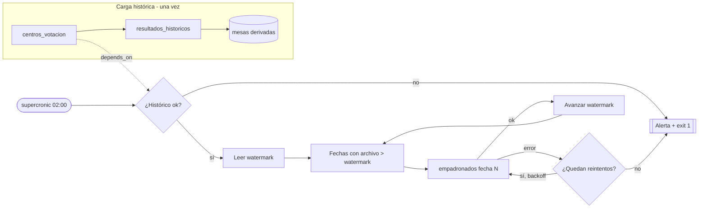

# Estrategia de orquestación

## 1. Herramienta seleccionada

**Elección:** cron en contenedor ([supercronic](https://github.com/aptible/supercronic)) + un orquestador liviano en Python (`orchestration/runner.py`) que implementa dependencias, reintentos, catch-up, backfill y alertas.

**Justificación:** son dos flujos, uno de ellos se ejecuta una sola vez y el otro una vez al día con ~18 mil filas. La lógica que importa (idempotencia, watermark, reproceso, cuarentena) ya vive en el ETL y en la base, así que el orquestador solo necesita disparar, encadenar y reintentar. Un servicio más en el mismo `docker-compose` lo levanta sin infraestructura adicional (sin metadatos propios, sin webserver, sin workers). Supercronic, a diferencia de `cron` clásico, hereda las variables de entorno del contenedor y escribe a stdout, por lo que las credenciales llegan por `.env` y los logs se ven con `docker compose logs`.

### 1.1 Comparación con alternativas

| Herramienta | Ventajas | Desventajas | Por qué (no) la elegí |
|---|---|---|---|
| **cron + contenedor + runner** | Cero infraestructura extra; reproducible con `docker compose up`; fácil de explicar | Sin UI ni historial propio (se cubre con `etl.ejecuciones`); reintentos implementados a mano | **Elegida**: proporcional al tamaño del problema |
| Airflow | Estándar de industria, UI, backfill nativo, sensores | Scheduler + webserver + base de metadatos: más pesado que el ETL mismo | Excesivo para dos DAGs; sería la opción con decenas de fuentes y equipo de datos |
| Prefect | Python nativo, reintentos por decorador, UI | Requiere servidor o Prefect Cloud para programar | Buena segunda opción; la migración es envolver `run_padron` con `@flow`/`@task` |
| Dagster | Assets y linaje, muy bueno para calidad | Curva de aprendizaje, más componentes | Útil si el proyecto crece a muchos assets dependientes |
| GitHub Actions | Gratis, programado, logs en GitHub | No llega a una base privada sin runner propio; los cron de Actions se retrasan | No apto para una base on-premise |

**Cuándo sería la elección equivocada:** con muchas fuentes y dependencias cruzadas, SLA por tarea, necesidad de UI para operadores no técnicos o ejecución distribuida. Ahí migraría a Airflow o Prefect: como el runner solo llama `build_pipeline(...).run()`, cada función pasa a ser una tarea sin tocar el ETL.

## 2. Diseño de los flujos

| Flujo | Disparador | Frecuencia | Depende de | Reintentos | Acción ante fallo |
|---|---|---|---|---|---|
| Carga histórica (`runner.py historico`) | Manual / al levantar el stack (`todo`) | Una vez (no se repite si ya terminó bien; `--force` para recargar) | Base creada (DDL + `02_control_etl.sql`) | 3, backoff exponencial 30 s, 60 s, 120 s | Rollback total de la tabla, `estado=error` en `etl.ejecuciones`, alerta, código de salida 1 |
| Carga incremental del padrón (`runner.py diario`) | supercronic `0 2 * * *` | Diaria 02:00 (America/Guatemala) | `centros_votacion` con ejecución `ok` (de `depends_on` en `config.yaml`) | 3, mismo backoff; no reintenta si el archivo no existe | Rollback del día, watermark sin avanzar, alerta; el siguiente disparo lo recupera (catch-up) |

### 2.1 Diagrama



## 3. Manejo de fallos

- **Reintentos:** 3 intentos con backoff exponencial (`ETL_RETRIES`, `ETL_BACKOFF_SECONDS`). Un archivo inexistente no se reintenta: es un problema de entrega, no transitorio.
- **Alertamiento:** cada fallo definitivo se registra en `etl.ejecuciones` (estado, error, métricas) y en log como `ALERTA`. Si se define `ALERT_WEBHOOK_URL` se envía un POST (formato Slack/Teams). Además, el flujo falla si los rechazos superan `quality.max_reject_ratio` (5%), para no cargar en silencio un archivo corrupto.
- **Idempotencia ante reejecución:** cada carga es una sola transacción; si falla no queda nada a medias. Reejecutar el histórico reemplaza el contenido de forma atómica y reejecutar una fecha del padrón da 0 cambios.

**Escenario: la carga de las 2 a.m. falló y nadie lo notó hasta las 10 a.m.** El padrón quedó en el estado del día anterior (consistente, solo desactualizado) y el watermark no avanzó. Basta con ejecutar `runner.py diario`: detecta todas las fechas pendientes desde el watermark y las procesa en orden. Si el problema persiste, el detalle está en `etl.ejecuciones.error` y los registros problemáticos en `etl.cuarentena`.

## 4. Backfill

```bash
# Una fecha puntual (si es anterior al watermark requiere --force en main.py)
python main.py load-empadronados --fecha 2026-03-03
python main.py load-empadronados --fecha 2026-03-03 --force

# Un rango, en orden (fuerza las fechas previas al watermark y reconstruye hasta la última)
python orchestration/runner.py backfill --desde 2026-03-02 --hasta 2026-03-04

# En Docker
docker compose run --rm etl-orchestrator python orchestration/runner.py backfill --desde 2026-03-02 --hasta 2026-03-04
```

Un backfill debe llegar **hasta la fecha más reciente**, porque cada fecha deja la tabla `empadronados` en la fotografía de ese día. La historia de movimientos por fecha se conserva en `etl.empadronados_snapshot`.

## 5. Cómo ejecutarlo

```bash
docker compose up -d postgres                         # base + DDL + esquema etl
docker compose run --rm etl-orchestrator python orchestration/runner.py todo   # histórico + padrón pendiente
docker compose up -d scheduler                        # programa el diario a las 02:00
docker compose logs -f scheduler
```

Sin Docker: `python orchestration/runner.py historico` y `python orchestration/runner.py diario`; para programarlo, agregar la línea de `orchestration/crontab` al cron del servidor.
